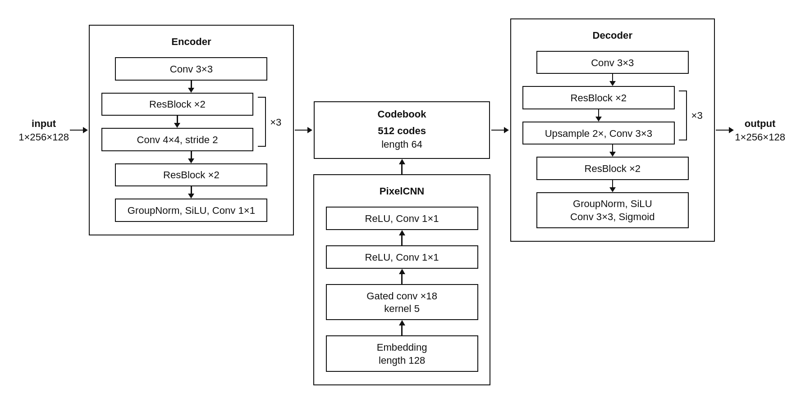
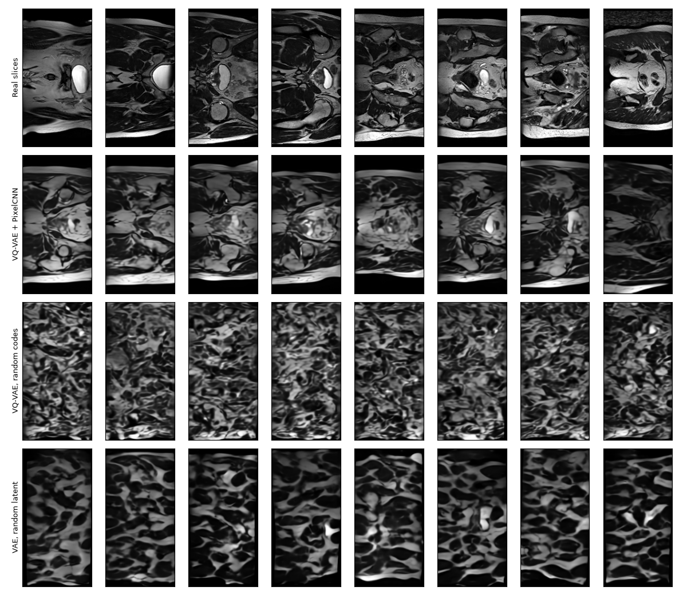
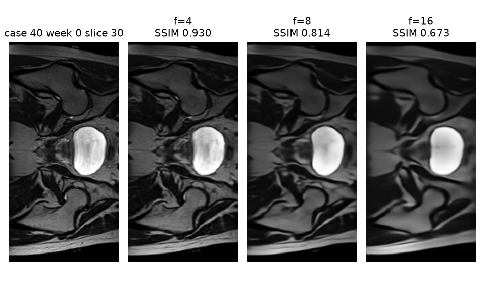
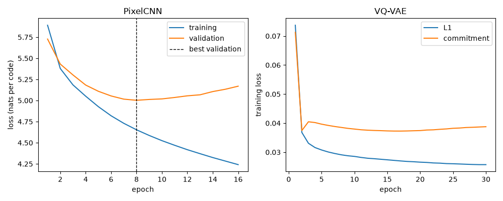
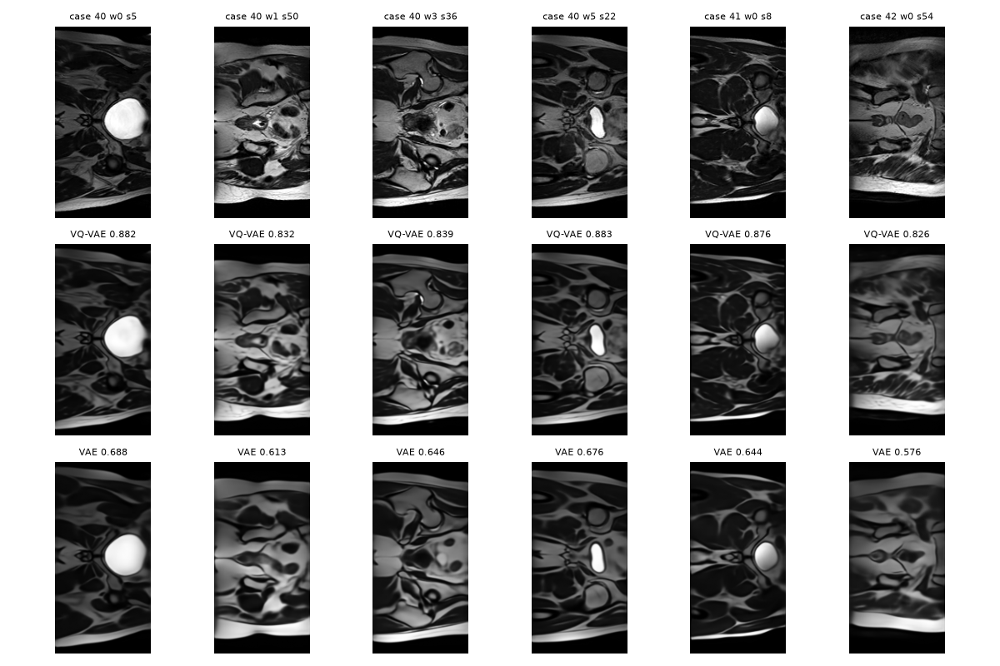
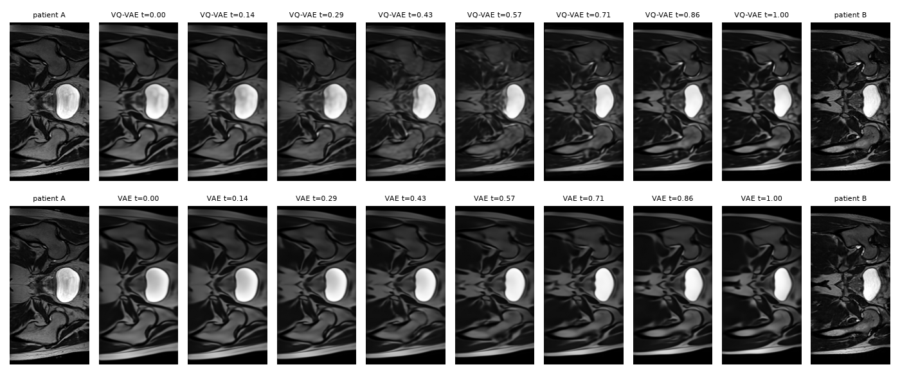
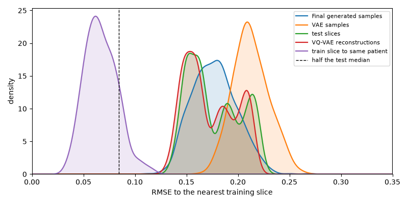
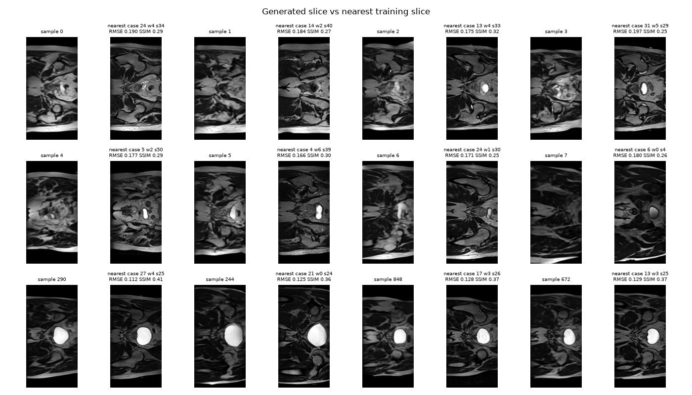
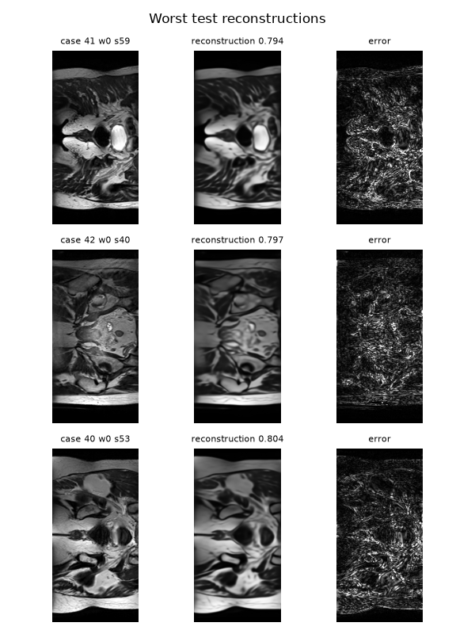
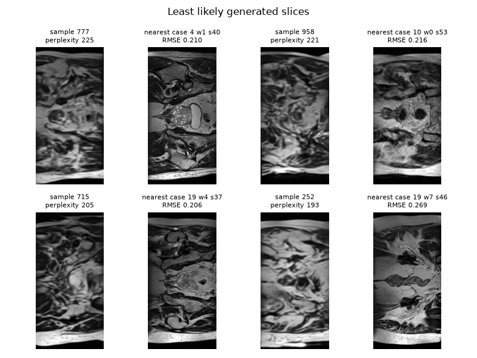

# Generating Realistic Prostate MRI Slices with VQ-VAE and PixelCNN

## 1. Problem and Algorithm

Radiotherapy planning can require large datasets of MRI slices and 3D scans. HipMRI is an example of one of these datasets, containing 2D pelvic slices from many different patients. However, due to patient scans typically not being shared freely, the amount of data researchers have available to them is limited. 

To increase the availability of prostate MRI slices, a neural network trained on patient scans can produce new images that look like real pevis anatomy without directly copying patients in its training set. One way of doing this is to use a VQ-VAE network. Plain autoencoders tend to produce blurry outputs, but a VQ-VAE avoids this by forcing every patch through a shared codebook of some number of learned vectors, converting each 2D slice to and from a grid of discrete codes. An autoregressive PixelCNN network can then learn to generate these grids, allowing for the generation of new, anatomically valid 2D slices. This approach will be tested and compared to a baseline VAE using normal sampling of latent vectors. 





## 2. Feasibility Report

### User Need, Scope & Acceptance Criteria

The intended user is a radiotherapy research group that wants to share or enlarge prostate MRI training data without exposing patient data. The prototype must show that the generative model can produce unique and diverse but faithful 2D slices on consumer hardware.

- **AC1:** Reconstruction fidelity on unseen test patients must have mean SSIM > 0.75 and 95% of slices must have SSIM > 0.6 (SSIM is the difference in brightness, contrast and structure).
- **AC2:** There must be no memorisation, so the median RMSE (pixel difference to the most similar training slice) for generated slices must not be more than 1% below that of unseen patient images, and none should have an RMSE lower than half the unseen patient median.
- **AC3:** Must be trainable on a basic consumer GPU with 8GB of VRAM (RX 6600 XT) in under 5 hours, and generating 1 slice must take less than 1 second.

### Model Choice & Course Concepts

A VQ-VAE network (hard difficulty) will be trained to encode and decode 2D slices into discrete codebooks, with the goal of accurate image reproduction. This will be paired with a PixelCNN prior network, which will be trained to generate realistic codebooks that decode to new 2D slices. VQ-VAE builds upon the VAE architecture used in the last lab by adding a quantisation layer to the middle of the network. Without this, VAEs tend to produce blurry, unconfident outputs, and encounter posterior collapse. So, with PixelCNN, this architecture should produce realistic, sharp images useable by researchers. This will be compared against a baseline VAE network with points sampled randomly from its latent space. The training set contains 11460 slices from 31 patients, the validation set contains 660 slices from 4 patients, and the test set contains 540 slices from 3 patients. There is no patient leakage.

### Preliminary Feasibility Evidence

The original 2D slices have a height and width of 256 x 128, with the exception of 60 slices from one scan (case_019_week_1), which were 256 x 144. These slices were dropped from the dataset. Images from the dataset can have different brightness levels and noise, so the images were normalised by scaling the brightness of all pixels so that the top 0.5% are given a brightness of 1. The background pixels were confirmed to have a brightness of 0.

Three VQ-VAE networks were trained for 4 epochs (took around 10 minutes each) and tested. The network with 2 stages, which shrinks the grid size by 4, had an SSIM of 0.940. The network with 3 stages (8x shrink) had an SSIM of 0.831, and the network with 4 stages (16x shrink) had an SSIM of 0.676. As too large of a codebook would slow down the PixelCNN training and sampling, the 3 stage network with a reasonably high reconstruction score was chosen as the base for the final VQ-VAE network.



### Risks, Budget & Fallback

**Risks:** Low number of test patients could result in inaccurate results. Codebook collapse could happen, which is when a network doesn’t use every codebook entry properly. This can be tracked with perplexity and managed using EMA.

**Budget:** <5 hours of training on the RX 6600 XT with ROCm PyTorch, and <1 second to generate each slice.

**Fallback:** The 2 stage network will be used instead if the solution doesn’t perform well enough, and the 4 stage network will be used if inference isn’t fast enough.

## 3. Dependencies and reproducibility

Install the packages in `requirements.txt` into a Python 3.12 environment. If using an AMD GPU, you will need the ROCm build of pytorch and torchvision. The versions used for the numbers below are:

| Package | Version |
|---|---|
| numpy | 2.5.2 |
| matplotlib | 3.11.2 |
| nibabel | 5.4.2 |
| tqdm | 4.70.1 |
| torch | 2.12.1 |
| torchvision | 0.27.1 |
| torchmetrics | 1.9.0 |
| torch-fidelity | 0.4.0 |
| scipy | 1.18.1 |

`torchvision`, `torchmetrics`, and `torch-fidelity` are used only to run Inception-v3 for FID. The VQ-VAE, the PixelCNN, and the VAE are trained from scratch using seed 42. Weights will be saved in `runs/vqvae/best.pt`, `runs/prior/best.pt`, and `runs/vae/best.pt`.

The loader looks for the course data at `/home/groups/comp3710/HipMRI_Study_open/keras_slices_data` and otherwise uses `./keras_slices_data`.

## 4. Usage

From this directory, with the virtual environment active:

```bash
python train.py vqvae
python train.py prior
python train.py vae
python predict.py
```

`train.py vqvae` trains the final model for 30 epochs at downsample factor 8 and two residual blocks per stage. `train.py prior` encodes the training slices with that checkpoint, then trains the PixelCNN for up to 60 epochs and stops after 8 epochs of validation loss not improving. `predict.py` writes the figures in `figures/` and the JSON files in `results/` while drawing 1000 new PixelCNN slices and 1000 VAE slices.

## 5. Data, pre-processing and splits

2D slices are already split by patient into `keras_slices_train`, `keras_slices_validate`, and `keras_slices_test`. After the size filter, the slice counts are 11460 from 31 patients, 660 from 4, and 540 from 3. `check_patient_leakage` confirms that no patient id appears in more than one split.

Every slice is 256 × 128, except for the 60 slices from `case_019_week_1`, which are 256 × 144 and are automatically dropped from the dataset. Each slice is divided by its own 99.5th-percentile intensity and clipped to [0, 1], so the brightest 0.5% of pixels sits at 1, while the background pixels stay at 0. Training slices only are then tilted by up to 8 degrees, shifted by up to 4 percent, scaled between 0.92 and 1.08, and brightened or darkened with a gamma between 0.8 and 1.25 to reduce memorisation and improve training. Validation, test, and the codes used to train the PixelCNN are not augmented at all.

## 6. Training and results

The VAE-based networks used the AdamW optimisation algorithm at 4e-4, with a 500-step linear warmup and a cosine decay down to 5 percent of that learning rate, batch size of 32, fp16, and gradient clipping at 1. The loss is L1 plus half of one minus SSIM, plus the codebook commitment term for the VQ-VAE or a KL term for the VAE. The KL weight is 0.05 and was warmed up over 3000 steps. The PixelCNN used AdamW at 3e-4, a batch size of 64, 18 gated layers of width 128, and cross-entropy on the code indices.  

A 3 stage VQ-VAE was chosen over 4 and 5 stage VQ-VAEs based on the results of the sweep tests, which ran for 4 epochs. This is because it achieves a reasonably high SSIM score of 0.831 with sharper results than a 5 stage VQ-VAE, and a 4x smaller latent grid than a 2 stage VQ-VAE (which would be much slower to sample). The final VQ-VAE keeps 3 stages and adds a second residual block per stage.

On the 540 unseen test slices, the VQ-VAE reconstructs with a mean SSIM of 0.857, worst slice SSIM of 0.795, and every slice SSIM above 0.6. MSE is 0.00226 and PSNR is 26.8 dB. Codebook perplexity rose from 27 in epoch 1 to about 389 of 512 codes by epoch 30, and dead code restarts eventually fell to zero. The VAE baseline, on the other hand, reaches mean SSIM 0.645, worst slice 0.521, and saw only 73.5 percent of slices achieve an SSIM of 0.6.

The PixelCNN's best validation loss was on epoch 8 (5.00 nats). Training loss kept falling through epoch 16 (4.65 to 4.24 nats) while validation loss rose (5.00 to 5.17), so epoch 8 was kept. The resulting test likelihood is 6.88 bits per code, against 9 bits for a uniform guess over 512 codes.



Reconstruction of test slices:



Interpolation between two test patients:



The three final runs took a total of 4.9 hours, and all fit within the 8 GB of VRAM on my RX 6600 XT. A separate inference-only memory figure was not recorded. Generation of one PixelCNN slice is under the one-second limit. This means AC3 was achieved. 

| Model    | Parameters | Peak training VRAM | Training time                | Generation        |
| -------- | ---------- | ------------------ | ---------------------------- | ----------------- |
| VQ-VAE   | 7.52 M     | 6.13 GB            | 116 min (30 epochs)          | included in below |
| PixelCNN | 12.50 M    | 2.02 GB            | 18 min (stopped at epoch 16) | 0.607 s/slice     |
| VAE      | 15.34 M    | 6.34 GB            | 160 min (best epoch 21)      | 0.002 s/slice     |

## 7. Open research dilemma

The question is whether the synthetic slices are new anatomy, copies of training patients, or just a blurred average. The table below compares the final VQ-VAE model to the VAE baseline, evaluated on the same patient-disjoint test split.

|                                                             | VQ-VAE + PixelCNN    | VAE baseline          |
| ----------------------------------------------------------- | -------------------- | --------------------- |
| Test reconstruction SSIM, mean / worst / fraction above 0.6 | 0.857 / 0.795 / 100% | 0.645 / 0.521 / 73.5% |
| Test MSE / PSNR                                             | 0.00226 / 26.8 dB    | 0.00735 / 21.7 dB     |
| FID against 2000 training slices                            | 146.0 (1000 samples) | 358.9 (1000 samples)  |

The final VQ-VAE network therefore passes AC1, as its mean reconstruction SSIM was above 0.75, and the absolute worst reconstruction had an SSIM significantly higher than 0.6. The VAE baseline, on the other hand, misses both these targets. 

Compared to 2000 training slices, the original test slices had an FID of 63.8, indicating notable similarity between the sets of images. Reconstructions of the test slices scored 166.7, meaning the new set of images lost some fidelity/diversity, which is evident in the 'smoothed' look of the output slices. The decoded PixelCNN samples hit an FID of 146.0, similar to but slightly less than that of the reconstructed slices, which indicates that they are also affected by the smoothing issue. The VAE was much further away from the training data, with an FID of 358.9.

To determine whether the networks are simply memorising the training data, the average RMSE difference between each output image and its closest slice in the training set can be calculated. The median difference between test slices and train slices is 0.169, compared to 0.06 for two train slices from the same patient. This shows that the test slices are notably different from the train slices in raw image contents, as expected. The final generated samples had a median of 0.177, sitting a bit further away than the test slices, however this difference can be explained by the smoothing from reconstruction, as the reconstructed training slices also have a slightly higher median RMSE compared to the original training slices.

AC2 states that the median RMSE of the final generated images should not sit more than 1% lower than the test slices, and that no individual generated slice should have an RMSE less than half the median for the group. Given that the RMSE for generated images was actually higher, and that the closest generated sample had an RMSE of 0.112, the final network passes AC3. 





The three worst test reconstructions are still acceptable by the SSIM rule, and seem to mostly stray from the original images in the fine grained details of the tissue between organs. This is shown in the error column of the image below.

Due to the 8x reduction in the dimensions of the image during encoding, the encoded grid cannot store the grain and sharp edges in the original image, so the decoder draws a smooth average. Slices near the end of a 3D scan make this worse because they contain more bright muscle and fat and less empty background.

The four least likely generated slices are samples 777, 958, 715, and 252, with prior perplexity 225, 221, 205, and 193. A typical test code grid is about 118. These images are washed out and the anatomy does not hold together. Their nearest training slices are still far away (RMSE 0.206 to 0.269), so this indicates failed generation rather than memorisation of the training data.





For a radiology project manager, the resulting generated slices are safe to show as synthetic data in the sense that they do not reproduce training patients. Their differences to the closest slices in the training set are still well above the same-patient range, and roughly match that of the real test slices. 

However, the generated images displayed clear smoothing between organs and structures in the MRI slices. As the FID of generated slices matched the FID of reconstructions, this means that the PixelCNN is not causing this, but rather, it occurs when the network attempts to upscale the grid downscaled by 8x during encoding. If sharper texture is required, the 3-stage VAE could be used instead of the current 4 stages, at the cost of a larger code grid, and slower training and sampling.  

## 8. AI Usage Disclosure

The Cursor IDE (with Auto selected) was used to show me how to write the code that does what I want, and troubleshoot issues whenever I hit roadblocks. 
I copied and pasted parts of this code, but wrote most of it myself, and ensured that I understood what every part of the code was doing before each commit. 
